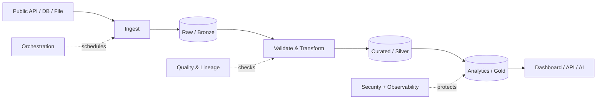
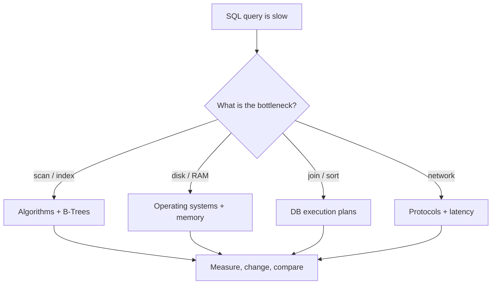

# Data Engineering Mastery

**מתואר בהנדסת תוכנה ועד Data Engineer שמסוגל לתכנן, לפתח, לפרוס, לאבטח ולתפעל תשתית נתונים מקצה לקצה.**

[English](README.en.md) · [מסלול מלא](docs/ROADMAP.he.md) · [מדריך הלומד](docs/LEARNER-HANDBOOK.he.md) · [וידאו ומחברות](docs/VIDEO-LEARNING.he.md) · [מנטור ChatGPT](prompts/MASTER-AGENT.he.md) · [GitHub/MCP](docs/GITHUB-MCP-SETUP.he.md)


> **סטטוס הפרויקט:** `v0.2.0` — חומרי למידה מורחבים, מחברות Jupyter, תרגילים, בדיקות, DataPulse starter ומדריכי פריסה. **לא** כל 14 השלבים ממומשים כמעבדות רצות; **לא** בוצעה פריסת ענן מאומתת. זה מסלול למידה ומערכת מתפתחת, לא הסמכת מקצוע או הבטחת תעסוקה.

## למי מיועד המסלול?

בוגר/ת הנדסת תוכנה שמכיר/ה כתיבת קוד, אך לא בהכרח Data Engineering. לא נניח שלמדת SQL מתקדם, Linux, רשתות, ענן או מערכות מבוזרות; נבצע אבחון ונלמד רק מה שחסר. דרוש מחשב, Git, Python 3.11+ וסקרנות. **אין צורך ב־GPU, מנוי ChatGPT בתשלום, חשבון ענן או Docker להתחלה.**

ההבדל בין **Data Analyst** (מפיק תובנות), **Data Scientist** (מפתח ניתוח ומודלים) ו־**Data Engineer** (בונה תשתיות מידע אמינות) נלמד כבר ב־Stage 00. כל שיעור מחבר *בעיה עסקית → נתונים → קוד → בדיקות → מדעי המחשב → פריסה → תפעול*.

## לימוד לרוחב — כדי לפתח ביטחון הנדסי אמיתי

ההתמחות המרכזית היא **Data Engineering**, אבל בכל שלב נלמד גם תחום משיק: מערכות הפעלה, אלגוריתמים, רשתות, אבטחה, סטטיסטיקה, ארכיטקטורה, מוצר ו-AI. לא נלמד הכל בבת אחת; 70% מהזמן נשארים בבניית Data Pipelines ו-20% בניסויי רוחב קטנים.

[**מסלול רוחב וביטחון — Foundations Passport**](docs/BREADTH-FOUNDATIONS.he.md) כולל 12 אתגרי חקר עם ניסוי עצמאי ומבחן העברה:

~~~bash
python3 scripts/breadth_quest.py recommend --stage 03
python3 scripts/breadth_quest.py show Q04
~~~

**ביטחון נבנה מהיכולת לחזות תוצאה, להריץ, לאבחן ולהסביר ללא AI; לא מהשלמת שעות או צפייה בסרטונים.** ניתן לדלג על Quest צדדי אם אינו קשור ליעד הנוכחי.

## מעבדות חדשות — למידה שמוכיחה יכולת

[**Foundations Labs — מדריך צעד אחר צעד לשלבים 01–03**](docs/FOUNDATIONS-LABS.he.md) כולל שלוש מעבדות מדורגות, גריידרים עם נתוני קצה, בדיקות קריסה ופתרונות ייחוס המיועדים לתחזוקה. מתחילים ב-SQL, ממשיכים ל-Python ול-ETL ב-SQLite; **הבדיקות של הלומד נכשלות בהתחלה בכוונה**. אין צורך בחשבון ענן או בהתקנת חבילות נוספות.

```bash
python3 labs/01-sql/grade.py
python3 labs/02-python/grade.py
python3 labs/03-etl/grade.py
```

להערכת המערכת (CI בלבד), פקודות אלה עם `--reference` אמורות לעבור. נתונים אמיתיים ופריסת Supabase מגיעים בשלבים הבאים, לאחר בניית היסודות.

## Stage 04 — PostgreSQL אמיתי לפני Supabase

[מעבדת PostgreSQL](labs/04-postgres/README.md) מריצה בדיקות רלוונטיות על בסיס נתונים זמני ללא חשבון ענן. התחל עם פקודת הייחוס: python3 labs/04-postgres/run_lab.py --reference. לאחר מכן נסה את תרגיל הלומד: python3 labs/04-postgres/run_lab.py, שייכשל בתחילה בכוונה. [פריסה לענן](docs/STAGE-04-SUPABASE-DEPLOY.he.md) היא שלב נפרד ואינה מאומתת עדיין.

## מה עושים עכשיו? בדיוק 10 צעדים

1. **יוצרים ריפו אישי:** כשמאגר זה יתפרסם כ־GitHub Template, לחצו **Use this template → Create a new repository**. אפשר להתחיל בריפו פרטי; אין חובה לפרסם את ההתקדמות האישית. אם קיבלתם ZIP, חילצו אותו ופתחו את התיקייה ב־VS Code. [הסבר](docs/GITHUB-MCP-SETUP.he.md).
2. **נכנסים לתיקיית השורש:** זה המקום שבו נמצאים `README.md`, `scripts/` ו־`curriculum/`. פתחו Terminal מתוך VS Code (`Terminal → New Terminal`).
3. **בודקים סביבת עבודה** (פקודות לקריאה בלבד, ללא שליחה לענן):

   ```bash
   python3 --version
   git --version
   python3 scripts/system_profile.py
   python3 scripts/validate_repo.py
   python3 -m unittest discover -s tests -v
   ```

   Windows: אם `python3` אינו מזוהה, נסו `py -3` במקום `python3`; את כל פקודות Python אפשר להריץ בהתאם. אם אין Python, התקינו מהאתר הרשמי או דרך מנהל חבילות מהימן. [פתרון תקלות](docs/TROUBLESHOOTING.he.md).
4. **בוחרים מסלול חומרה:** המחשב מקבל המלצה `light` / `moderate` / `full`. RAM/CPU אינם ציון היכולות שלכם; גם במחשב חלש אפשר להשלים את המסלול עם SQLite, DuckDB וקבצים קטנים. אין צורך לשתף את פלט החומרה המלא. [הסבר מפורט](docs/ENVIRONMENT.he.md).
5. **פותחים מצב התקדמות מקומי ואישי:**

   ```bash
   python3 scripts/roadmap.py init --alias learner
   python3 scripts/roadmap.py status
   python3 scripts/roadmap.py next
   python3 scripts/roadmap.py start 00
   ```

   הקובץ האישי `learner/progress.json` מוחרג מ־Git ולא מועלה אוטומטית. **אם כבר התחלתם**, דלגו על `init` (הסקריפט מסרב לדרוס התקדמות קיימת).
6. **פותחים את המנטור:** קראו [MASTER-AGENT.he.md](prompts/MASTER-AGENT.he.md), הדביקו את פקודת הפתיחה שבסופו ל־ChatGPT, ואפשרו לו לקרוא את הריפו רק אם חיברתם אותו מרצון. [חיבור ChatGPT ו־GitHub MCP הם שני מסלולים שונים](docs/GITHUB-MCP-SETUP.he.md); לא צריך אף אחד מהם כדי להתחיל.
7. **עושים אבחון לפני הלימוד:** המנטור בוחן SQL, Python, Linux, HTTP, תכנון DB, מורכבות ואבחון תקלות. מסבירים *למה* בחרנו תשובה. אפשר לדלג על חומר מוכר לאחר הוכחת יכולת, לא לפי תואר בלבד. [פרוטוקול מפגש](docs/LEARNER-HANDBOOK.he.md#אבחון-והתאמה-אישית).
8. **נכנסים למחברת הראשונה:** [Notebook 00 — מסע הנתון](notebooks/00_data_journey.ipynb) ואחר כך [Notebook 01 — SQL Detective](notebooks/01_sql_detective.ipynb). מחברות הן תרגילים קטנים, עצמאיים וללא ענן. [איך לצפות בסרטון תוך כדי עבודה](docs/VIDEO-LEARNING.he.md).
9. **מבצעים את הפרויקט הראשון:** `python3 labs/01-sql/run_lab.py`, עוברים על [Stage 00](curriculum/modules/00.md), כותבים קוד בעצמכם, פותחים Branch ו־PR, ומציגים בדיקות. לא נוגעים ב־Supabase production בשלב זה.
10. **מגישים מבחן מעבר** ומסכמים: ראיית קוד, תוצאות בדיקות, שתי שאלות ללא AI, הסבר tradeoffs, וה־Side Quest. לעדכון עצמי (לא הסמכה):

   ```bash
   python3 scripts/roadmap.py complete 00 --evidence "local tests and PR" --reflection "הסבר של לפחות ארבעים תווים על מה בניתי, למה וכיצד בדקתי" --quiz-notes "עניתי עצמאית על שתי שאלות בחינה"
   python3 scripts/roadmap.py status
   python3 scripts/roadmap.py next
   ```

### השבוע הראשון — מה עושים בכל יום?

| יום | משימה מדויקת | הוכחה שהושלמה |
|---|---|---|
| 1 | חשבון GitHub, Clone/Template, VS Code, Python/Git | ריצה של `validate_repo.py` |
| 2 | אבחון חומרה + 5 שאלות אבחון SQL/Python/CS | סטטוס Stage 00 + מפת פערים מקומית |
| 3 | Notebook 00, צפו בקטע הווידאו והסבירו את תנועת הנתונים | `assert` עובד והסבר של מקור/דחייה/כפילות |
| 4 | Notebook 01 ו־SQL Detective | שאילתת JOIN חדשה וניתוח `EXPLAIN QUERY PLAN` |
| 5 | ניסוי Parser: שברו שדה JSON והוסיפו test | בדיקה אדומה ואחר כך ירוקה |
| 6 | Branch + PR, Review עם AI, שתי שאלות ללא עזרה | PR כולל פקודות, ראיות והחלטות |
| 7 | מבחן Stage 00, השלימו רק אם עמדתם ב־Exit Gate | הערכה, רפלקציה והצעד הבא |

הזמן היומי גמיש. אם נושא כבר מוכר, הוכיחו בקוד והמשיכו. אם בדיקה נכשלת, עוצרים ומתקנים — לא מסתירים את הכשל בעזרת ציון הצלחה ידני.

**אם משהו נתקע:** אל תדלגו על האזהרה. חפשו ב־[מדריך פתרון תקלות](docs/TROUBLESHOOTING.he.md), בצעו ניסוי מינימלי, תעדו את הפלט המסונן ופנו למנטור עם מה שכבר ניסיתם.

## כך נראה המסע — ממקור הנתונים עד למוצר



**למה חשוב ללמוד מדעי המחשב?**



## מפת הדרך: 14 שלבים, פרויקט מתפתח אחד, מבחני מעבר

| שלב | נושא | מה בונים | מדעי המחשב שבדרך | שער יציאה |
|---|---|---|---|---|
| [00](curriculum/modules/00.md) | Onboarding + אבחון | סביבת עבודה, אבחון חומרה | Linux, Git, תהליכים | בדיקות + הסבר data flow |
| [01](curriculum/modules/01.md) | SQL ו־Postgres | שאילתות ו־EXPLAIN | B-Trees, complexity, transactions | תוכניות ביצוע מנומקות |
| [02](curriculum/modules/02.md) | Python Data | Parser ו־validation | טיפוסים, זיכרון, אלגוריתמים | יחידות ופינות קצה |
| [03](curriculum/modules/03.md) | ETL / ELT | Batch ingest ו־dedup | consistency, idempotency | הרצה חוזרת ללא כפילויות |
| [04](curriculum/modules/04.md) | Supabase | DB, migrations, RLS | ACID, auth, privilege | בדיקת הרשאות אמיתית |
| [05](curriculum/modules/05.md) | Modeling | Dimensional model + marts | normalization, OLAP | תוצאות נכונות ומוסברות |
| [06](curriculum/modules/06.md) | Orchestration | DAG, retries, backfill | state machines, time | שחזור הרצה שנכשלה |
| [07](curriculum/modules/07.md) | Data Quality | contracts, lineage | invariants, statistics | נתון פגום נחסם |
| [08](curriculum/modules/08.md) | Analytics | Serving + dashboard | caching, APIs, privacy | נתונים מדויקים וגישה בטוחה |
| [09](curriculum/modules/09.md) | Cloud / CI/CD | build, deploy, rollback | networks, infra, IAM | פריסה ואימות מרחוק |
| [10](curriculum/modules/10.md) | Spark | distributed batch | partitioning, shuffles | benchmark וניתוח בחירה |
| [11](curriculum/modules/11.md) | Kafka | stream consumer | ordering, backpressure | duplicate / restart tests |
| [12](curriculum/modules/12.md) | Production | monitoring + recovery | fault tolerance, security | incident rehearsal |
| [13](curriculum/modules/13.md) | Capstone | product end-to-end | systems design | case study + review |

**איך יודעים אם זה מספיק לרמת עבודה?** לא לפי אחוז צפייה. כל מודול דורש קוד/שאילתה, בדיקות, הסבר עצמאי ותיעוד. קראו [קריטריוני ההערכה](docs/ASSESSMENT.md), [מטריצת הכישורים](docs/MASTERY-MATRIX.he.md) ו־[מפת פרויקטי ההמשך](docs/PROJECT-LADDER.he.md). אחרי Stage 13 מתקדמים למסלולי התמחות ב־Lakehouse, Analytics, Streaming, Data Platform ו־AI Data Infrastructure.

## למידה שלא משעממת: ניסוי, סרטון, בעיה, גילוי


בכל מפגש 50–90 דקות: **חידת פתיחה → ניסיון עצמאי → הסבר קצר/סרטון ממוקד → מימוש → שבירת המערכת בכוונה → תיקון → שאלה במדעי המחשב → הוכחת הבנה**. אפשר לבחור סגנון `investigator`, `builder`, `detective` או `production`:

```bash
python3 scripts/session_plan.py --style investigator --level intermediate --minutes 60
```

התיעוד משתנה בהתאם לידע ולמחשב, אבל שערי האיכות לא משתנים. [דוגמת תרחישי חקר](docs/LEARNER-HANDBOOK.he.md), [משימות צד](curriculum/side-quests.json) ו־[מסלול מדעי המחשב](docs/COMPUTER-SCIENCE-BRIDGES.he.md).

### מחברות וסרטונים

| מחברת | צפייה משלימה | מה מתרגלים |
|---|---|---|
| [00 — Data Journey](notebooks/00_data_journey.ipynb) | [מהו Orchestration?](https://www.youtube.com/watch?v=-JLnp-iLins) | מקור → בדיקות → תובנות |
| [01 — SQL Detective](notebooks/01_sql_detective.ipynb) | [CS50 SQL](https://www.youtube.com/watch?v=WXk7yDqsKxs) | joins, group by, indexes |
| [02 — ETL Failure Lab](notebooks/02_etl_failure_lab.ipynb) | [Ingestion workshop — dlt](https://www.youtube.com/watch?v=5eMytPBgmVs) | dedup, retries, malformed rows |
| [03 — Pipeline Observatory](notebooks/03_pipeline_observatory.ipynb) | [Scheduling & Backfills](https://www.youtube.com/watch?v=1pu_C_oOAMA) | latency, failure rate, alerts |

ב־Jupyter אפשר להציג YouTube באמצעות נגן מוטמע, אם הרשת/הסביבה מאפשרות זאת. **ב־GitHub preview אין להסתמך על נגן מוטמע**: לכל מחברת יש קישור צפייה רגיל כדי שהלומד לא ייתקע. הסרטונים שייכים ליוצריהם, ואינם מועתקים לריפו. [כל ההוראות והקישורים](docs/VIDEO-LEARNING.he.md).

## Stage 06 — תזמור ושחזור טעינות

[**מעבדת Orchestration, Retries & Backfills**](labs/06-orchestration/README.md) מתרגלת תלויות DAG, תכנון חלונות, Retry מוגבל, מניעת כפילויות, Rollback והתאוששות לאחר אובדן אישור Commit. היא פועלת באופן מקומי ב־Python ו־SQLite. קובץ התרגול מתחיל לא פתור, והבדיקות הן חלק מתהליך הלמידה.

## Stage 07 — איכות, חוזים ו־Lineage

[**מעבדת איכות נתונים עם 27 תרחישי בדיקה**](labs/07-quality/README.md) עוסקת בזיהוי Schema Drift, נתונים חסרים, כפילויות, Freshness, Quarantine ופרסום אטומי. פועלת ללא שירות ענן, עם תרגול לא פתור ובדיקות Reference ב־CI.

## Stage 08 — דשבורד API מאובטח להדגמה

[**DataPulse Observatory — API לקריאה בלבד ודשבורד עם מדדי איכות**](labs/08-serving/README.md). שרת Python מקומי משרת מדדים מקובץ SQLite סינתטי, מציג אזהרות Freshness, מידע על ריצות חסומות, ומונע גישה לנתונים גולמיים ולפעולות כתיבה. נתיב ההפעלה: `python3 labs/08-serving/serve.py`. זו הדגמה מקומית ולא שירות Production.

## Stage 09 — Build, CI/CD ו־Rollback

[**מעבדת Stage 09 — Release Reproducibility & Recovery**](labs/09-cicd/README.md) מלמדת לבנות Artifact שחזורי, לאמת SHA-256, להפריד סביבות, לבצע Health Gate לפני Promotion ולבצע Rollback בטוח באמצעות 26 בדיקות. הסימולציה פועלת ללא שרת, ענן או סודות: `python3 labs/09-cicd/demo.py`. ב־CI נבדק פתרון הייחוס; קוד הלומד מתחיל לא פתור.

## הפרויקט המרכזי — DataPulse

[DataPulse](projects/datapulse/README.md) קולט אירועי רעידות אדמה מ־USGS, מבצע Validation, טוען נתונים ושולח ל־Dashboard. מתחילים ב־Fixture סינתטי, אחר כך SQLite/SQL, בהמשך Supabase, Orchestration, QA, Monitoring, פריסה ו־Recovery. **כל הרחבה היא PR נפרד עם Definition of Done**. ראו [מפת הפרויקטים](docs/PROJECT-LADDER.he.md).

```bash
PYTHONPATH=projects/datapulse/src python3 -m unittest discover -s projects/datapulse/tests -v
PYTHONPATH=projects/datapulse/src python3 -m datapulse.ingest \
  --fixture projects/datapulse/data/sample.geojson --dry-run
```

## מדריך פעולה לפי מצב

| אני רוצה… | פתח כאן |
|---|---|
| להתחיל מאפס במחשב חדש | [מדריך הלומד](docs/LEARNER-HANDBOOK.he.md#יום-0--הקמה-ללא-ענן) |
| לבחור מה לרוץ על המחשב שלי | [סביבת עבודה](docs/ENVIRONMENT.he.md) |
| לחבר GitHub, ChatGPT או MCP | [מדריך חיבור](docs/GITHUB-MCP-SETUP.he.md) |
| ללמוד עם וידאו ב־Jupyter | [מחברות וסרטונים](docs/VIDEO-LEARNING.he.md) |
| לפתור שגיאת Docker/SQL/Auth | [Troubleshooting](docs/TROUBLESHOOTING.he.md) |
| לדעת מה אני באמת יודע | [מטריצת שליטה](docs/MASTERY-MATRIX.he.md) |
| לפרוס Supabase וממשק | [Deployment checklist](projects/datapulse/DEPLOYMENT-CHECKLIST.he.md) |
| להציע תרגיל או תיקון לציבור | [CONTRIBUTING](CONTRIBUTING.md) |
| לפרסם את הריפו הראשי כתבנית | [מדריך המתחזק](docs/PUBLISHING.he.md) |

## כללי זהב לפרויקט ציבורי

- **אין מפתחות ב־Git:** לא מפרסמים `.env`, service-role, PAT, נתוני משתמשים, נתונים מוגנים או מידע חומרתי אישי. בדיקת סודות לפני PR היא חובה.
- **לומדים לפני שמפעילים סוכן:** מותר AI לרמז, Review ויצירת בדיקות; יכולת עצמאית נבחנת בלי פתרון מוכן. אין להציג עבודה של AI כהוכחה אישית לבקיאות.
- **לא נוגעים ב־Production בלי אישור:** עלות, מחיקה, שינוי הרשאות, `db reset --remote`, Merge ופריסה דורשים בדיקה ואישור.
- **חומרה חלשה אינה חסם:** מתחילים על Data קטן ואותן דרישות מושגיות, ורושמים אילו בדיקות ענן/ביצועים עדיין לא הושלמו.
- **פתוח לכולם:** מדריכים בעברית, דף English ותרומות קהילה. [MIT License](LICENSE) · [SECURITY](SECURITY.md) · [CONTRIBUTING](CONTRIBUTING.md).

> **שיעור ראשון, ברגע זה:** פתחו את [Notebook 00](notebooks/00_data_journey.ipynb), ענו בכתב: *אם קיבלנו 1,000 אירועים מה־API ו־17 נפסלו, מה נוכל לטעון בוודאות על איכות המידע?* אחר כך הפעילו את הבדיקות והסבירו מה עדיין לא הוכח.
