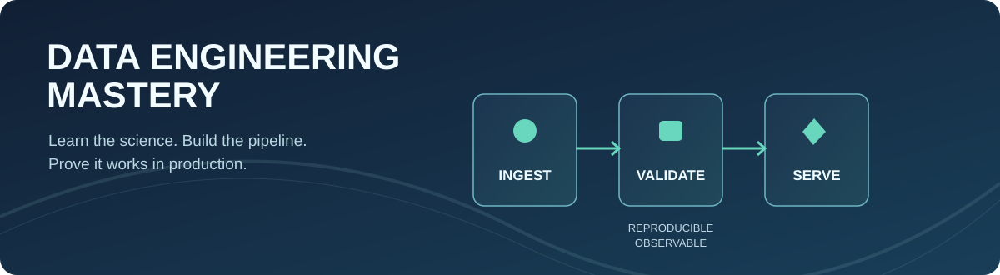
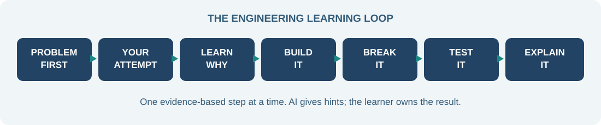

# Data Engineering Mastery

**A complete, practical, English-first learning pathway from software engineering to Data Engineering.** Learn the concepts, write real code, break it safely, fix it, and show reproducible evidence.

The repository contains **14 stages (00–13)**, guided Jupyter notebooks, graded labs, reference implementations for maintainers, independent learner exercises, and a synthetic end-to-end DataPulse capstone. All exercises use reproducible synthetic datasets; real cloud environments are strictly optional and require separate owner authorization.

[**Start learning**](docs/QUICKSTART.en.md) · [**Visual VS Code setup**](docs/VS-CODE-LEARNING-SETUP.md) · [**Course map**](docs/training-manifest.json) · [**Capstone**](capstone/README.md) · [**Final assessment**](docs/FINAL-ASSESSMENT.he.md)

## Start here: read the lessons visually

Do **not** open a `.ipynb` file as raw JSON. This course is designed for **VS Code with rendered Markdown and visual Jupyter notebooks**.

1. **Clone or open this repository** in Visual Studio Code (**File → Open Folder**).
2. Install the recommended extensions from the notification or follow the [one-page VS Code setup](docs/VS-CODE-LEARNING-SETUP.md): **Python**, **Jupyter**, **Markdown All in One**, **Markdown Preview Enhanced**.
3. Open this `README.md` or a stage module; press **Cmd+Shift+V** (macOS) / **Ctrl+Shift+V** (Windows/Linux) to view the formatted Markdown, diagrams and tables. Use **Cmd/Ctrl+K, V** for side-by-side preview.
4. Open [notebooks/00_data_journey.ipynb](notebooks/00_data_journey.ipynb): it should display notebook **cells**, not JSON. Select a Python kernel when prompted.
5. Run the reference exercise once to verify that the lab itself works:

~~~bash
python3 labs/00-onboarding/grade.py --reference
~~~

6. Implement the **separate learner starter**, intentionally unfinished at first:

~~~bash
python3 labs/00-onboarding/grade.py
~~~

7. Explain the test result, add a new failure case, and submit evidence in your own branch. Then continue to [Stage 01](curriculum/modules/01.md).

You can install all four VS Code extensions on macOS/Linux from a terminal in this repository:

~~~bash
bash scripts/install-vscode-extensions.sh
~~~

On **Windows**, open PowerShell in the repository and run:

~~~powershell
powershell -NoProfile -File .\scripts\install-vscode-extensions.ps1
~~~

The installation is **optional and user-initiated**. The repository cannot install extensions in your local editor without your action.

## What you will learn

| Stage | Topic | Practice | Notebook |
| --- | --- | --- | --- |
| [00](curriculum/modules/00.md) | Environment, Git and data flow | Readiness, safe paths and DAG reasoning | [Open](notebooks/00_data_journey.ipynb) |
| [01](curriculum/modules/01.md) | SQL, relational models and query plans | Joins, cardinality, transactions and indexes | [Open](notebooks/01_sql_detective.ipynb) |
| [02](curriculum/modules/02.md) | Python data foundations | Typed parsing, validation and unit tests | [Open](notebooks/02_etl_failure_lab.ipynb) |
| [03](curriculum/modules/03.md) | Batch ETL and incremental processing | Idempotent SQLite loads and late corrections | [Open](notebooks/03_pipeline_observatory.ipynb) |
| [04](curriculum/modules/04.md) | PostgreSQL and row-level security | Real local PostgreSQL migrations, role denial tests | [Open](notebooks/04_postgres_security.ipynb) |
| [05](curriculum/modules/05.md) | Warehouse modeling and dbt | Fact/dimension schema, SCD2 and dbt marts | [Open](notebooks/05_scd2_modeling.ipynb) |
| [06](curriculum/modules/06.md) | Orchestration and retries | DAGs, bounded backfill and durable checkpoints | [Open](notebooks/06_dag_recovery.ipynb) |
| [07](curriculum/modules/07.md) | Data contracts, quality and lineage | Quarantine, freshness, completeness and atomic publish | [Open](notebooks/07_quality_contracts.ipynb) |
| [08](curriculum/modules/08.md) | Read-only analytics serving | Local API, quality-aware dashboard and KPI definition | [Open](notebooks/08_readonly_serving.ipynb) |
| [09](curriculum/modules/09.md) | CI/CD and release engineering | Reproducible artifacts, health gates and rollback | [Open](notebooks/09_releases_rollback.ipynb) |
| [10](curriculum/modules/10.md) | Big Data and Spark | Light Map/Reduce, local PySpark and shuffle/skew | [Open](notebooks/10_spark_partitioning.ipynb) |
| [11](curriculum/modules/11.md) | Streaming and Kafka | Offsets, replay, safe local sink and Kafka broker | [Open](notebooks/11_streaming_offsets.ipynb) |
| [12](curriculum/modules/12.md) | Reliability and recovery | SLOs, error budgets, RBAC, backups and incident drills | [Open](notebooks/12_slo_recovery.ipynb) |
| [13](curriculum/modules/13.md) | Capstone, portfolio and assessment | Integrated DataPulse pipeline and independent examination | [Open](notebooks/13_integrated_capstone.ipynb) |

Every stage links to a lesson, a practical lab, a graded test, and a separate student implementation task. The expected first result of an unfinished learner exercise is a **failing test**; instructors run `--reference` to validate the test suite.

## How the course works

**Learn → Predict → Build → Break → Repair → Explain → Transfer.** Read a concept, predict its behavior, implement your own solution, inject a controlled failure, add a regression test, then explain a *different* scenario without AI. Simply watching videos or copying reference solutions is not a passing result.

The progression is **competency-based, not time-based**. The [teaching plan](docs/TEACHING-PLAN.he.md) provides a suggested schedule, [learner handbook](docs/LEARNER-HANDBOOK.he.md) explains the daily workflow, and the [mastery matrix](docs/MASTERY-MATRIX.he.md) defines evidence requirements. You may spend longer on advanced stages until the skills are demonstrable.

Each major topic includes a bridge back to computer science: [algorithms](curriculum/cs-bridges/algorithms.md), [databases](curriculum/cs-bridges/databases.md), [networking](curriculum/cs-bridges/networking.md), [operating systems](curriculum/cs-bridges/operating-systems.md), [distributed systems](curriculum/cs-bridges/distributed-systems.md), [security](curriculum/cs-bridges/security.md), [statistics](curriculum/cs-bridges/statistics.md) and [architecture](curriculum/cs-bridges/architecture.md). Optional [breadth quests](docs/BREADTH-FOUNDATIONS.he.md) build confidence beyond any individual tool.

## Running the code

The **Light path** requires Python 3.11+ and the standard library; begin here on any ordinary computer. The **full local path** adds Docker/PostgreSQL, dbt, Java 17/PySpark and single-broker Kafka exercises when your machine supports them. No GPU is required.

~~~bash
# Curriculum metadata, documentation links and notebook structure
python3 scripts/validate_repo.py
python3 scripts/audit_program.py

# Execute the new notebooks' Python cells without a Jupyter server
python3 scripts/notebook_smoke.py

# General local regression tests
python3 -m unittest discover -s tests -v

# Independently graded end-to-end instructor reference
python3 capstone/grade.py --reference
python3 capstone/demo.py
~~~

See the [notebook index](notebooks/README.md) for the full visual-learning workflow. The setup instructions distinguish **viewer dependencies** (Jupyter, Markdown preview) from **execution dependencies** (PySpark, Kafka) so you do not install unnecessary heavyweight packages.

### The DataPulse capstone

The final project demonstrates a synthetic event pipeline, not a real earthquake warning service:

~~~mermaid
flowchart LR
  A[Synthetic event source] --> B[Validate and checkpoint]
  B --> C[Curated data]
  C --> D[Read-only API and dashboard]
  C --> E[Verified backup and restore]
  D --> F[Quality and freshness evidence]
  E --> G[Controlled release and rollback]
  F --> H[Capstone assessment]
  G --> H
~~~

Start with [DataPulse](projects/datapulse/README.md), then complete the [capstone specification](capstone/specification.md), [22-case capstone grader](capstone/README.md), an independent transfer exam, and the required architecture, security and operations evidence.

## Personal learning progress and assessment

Keep learner work separate from instructor references. A passing reference test proves that **the teaching solution and grader work**, not that you wrote the learner solution.

~~~bash
python3 scripts/roadmap.py init --alias learner
python3 scripts/roadmap.py status
python3 scripts/roadmap.py next
~~~

Your `learner/progress.json` is local and gitignored. See [learner/README.md](learner/README.md) for safe progress tracking. Do not publish raw system profiles, credentials or personal records.

The [final assessment](docs/FINAL-ASSESSMENT.he.md) checks all 14 stages, independent code, unseen tasks, operational failure recovery, architecture decisions, a ten-minute capstone demonstration and a qualified human review. The [assessment validator](assessment/evaluate.py) verifies the **structure** of evidence, not its truth. This repository does not automatically issue certificates.

## Responsible scope and limitations

- **Implemented and locally tested:** teaching material and instructor labs across stages 00–13, including isolated PostgreSQL/dbt, local PySpark, a disposable Kafka broker and the synthetic capstone.
- **Not proven by CI alone:** student competence, a beginner pilot, production security, real multi-node scale, cross-system exactly-once, cloud deployment or disaster-recovery RPO/RTO.
- **No external accreditation:** the program can support an accurately labeled *internal* completion review only after independent assessment; it is not a vendor or officially recognized professional certification.
- **Cloud work needs permission:** never use a real Supabase project, live database, production Kafka broker or billable infrastructure without explicit owner authorization. [Cloud deployment guidance](docs/STAGE-04-SUPABASE-DEPLOY.he.md) is optional.

See [program readiness](docs/PROGRAM-READINESS.he.md), [the maintainers' roadmap](docs/MAINTAINER-ROADMAP.he.md), and [the security policy](SECURITY.md) for release gates and safe contribution practices.

## Documentation navigation

| Goal | Document |
| --- | --- |
| Start with a terminal and no cloud account | [Quickstart](docs/QUICKSTART.en.md) |
| Install VS Code extensions and view files visually | [Visual editor setup](docs/VS-CODE-LEARNING-SETUP.md) |
| Choose the next stage and schedule practice | [Teaching plan](docs/TEACHING-PLAN.he.md) |
| Develop breadth and computer science confidence | [Breadth foundations](docs/BREADTH-FOUNDATIONS.he.md) |
| Learn the SQL/Python/ETL foundations carefully | [Foundations labs](docs/FOUNDATIONS-LABS.he.md) |
| Work through video and notebook resources | [Video learning](docs/VIDEO-LEARNING.he.md) |
| Diagnose environment, SQL or notebook errors | [Troubleshooting](docs/TROUBLESHOOTING.he.md) |
| Determine whether you have independent evidence | [Mastery matrix](docs/MASTERY-MATRIX.he.md) |
| Prepare for a real capstone defense | [Final assessment](docs/FINAL-ASSESSMENT.he.md) |
| Understand the roadmap and advanced paths | [Roadmap](docs/ROADMAP.he.md) |
| Work with GitHub and security-aware coding agents | [Agent guide](prompts/MASTER-AGENT.en.md) |

The course, examples and reference implementations are provided for learning. [Contribute](CONTRIBUTING.md) with original work, safe test fixtures and clear change notes.
