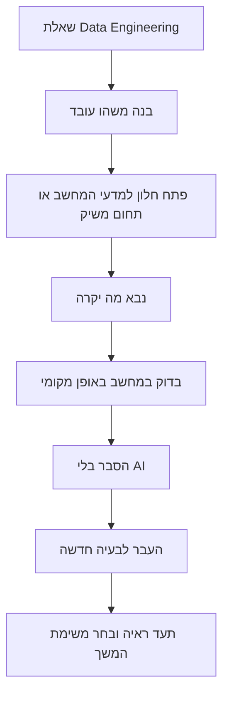

# מסלול רוחב וביטחון הנדסי — Foundations Passport

[חזרה ל-README](../README.md) · [מפת Data Engineering](ROADMAP.he.md) · [מטריצת שליטה](MASTERY-MATRIX.he.md)

## למה מסלול נוסף?
מטרת הריפו היא להכשיר Data Engineer, אבל בוגר הנדסת תוכנה זקוק גם **למפת עולם טכנולוגית רחבה** כדי להבין בעיות חדשות, לבחור כלים ולדבר בביטחון עם צוותי Backend, SRE, Security, Analytics ו-AI.

**העיקרון:** עומק מקצועי ב-Data Engineering + רוחב מוכח במקצועות משיקים. לא לומדים 12 מסלולים מקבילים, לא מתחילים מחדש תואר שלם, ולא טוענים שידע בסרטון שווה ניסיון מעשי.



## איך משלבים רוחב בלי לאבד מומחיות?
ברירת המחדל ל-10 שעות שבועיות: **7 שעות לליבת Data Engineering, שעתיים למסלול רוחב משיק, שעה לסיכום/חזרה/תרגול ללא AI**. בלוח זמנים של 5 שעות: כ-3.5 שעות ליבה, שעה רוחב וחצי שעה חזרה. אלה יחסי תכנון, לא דרישה להתקדם לפי שעון.

לכל Stage מתאימה לפחות משימת רוחב אחת. משימת הרוחב **אינה תנאי מעבר אוטומטי**; היא הופכת לחובה רק כאשר אבחון גילה חוסר ידע המונע משימה בטוחה או נכונה. מחסור ב-GPU, בענן או ב-RAM לא מונע התקדמות תאורטית עם סימולציה.

## דרכון הרוחב — 12 תחומים
| תחום | למה הוא חשוב ל-Data Engineer | תחנת תרגול |
|---|---|---|
| חומרה ומערכות הפעלה | זיכרון, דיסק, תהליכים, CPU מול I/O | 00 |
| אלגוריתמים ומבני נתונים | אינדקסים, סיבוכיות, תכנון שאילתות | 01 |
| הנדסת תוכנה ובדיקות | קוד אמין, חוזים, דיבוג ורגרסיות | 02 |
| רשתות ו-HTTP | APIs, timeouts, retries, backpressure | 03 |
| אבטחת מידע | IAM, RLS, מפתחות ועיקרון מינימום הרשאות | 04 |
| מתמטיקה וסטטיסטיקה | הטיות, מדדים, אוכלוסייה, איכות | 05/07 |
| גרפים, תזמון ותורת המערכות | DAGs, state, תלויות וכשלים | 06 |
| אתיקה ו-Data Governance | פרטיות, provenance, רישיונות ו-retention | 07/12 |
| מוצר, UX והגדרת מדדים | שימושיות, חוזי מדדים, תקשורת עם צוות | 08 |
| Cloud Economics ו-FinOps | עלויות, חלופות, אחריות תפעולית | 09 |
| מערכות מבוזרות | סדר אירועים, replay, סמנטיקות מסירה | 10/11 |
| אוריינות AI ותקשורת טכנית | אימות מקורות, Benchmark וכתיבת Case Study | 13 |

בנוסף, לאחר Capstone ניתן לבחור חקר קצר ברובוטיקה, Embedded, Computer Vision, פיתוח מובייל, חישוב מקבילי או אבטחת ענן — **לא כחלק משערי ההסמכה של Data Engineering**, אלא כדרך לפתוח תחומי עניין.

## ביצוע מעשי — במחשב של הלומד
```bash
python3 scripts/breadth_quest.py list
python3 scripts/breadth_quest.py recommend --stage 03
python3 scripts/breadth_quest.py show Q04
python3 scripts/breadth_quest.py check
```

הסקריפט אינו סורק חומרה, אינו מתחבר לענן, אינו שולח טלמטריה ואינו משנה את ההתקדמות האישית. הוא מציע משימות מובנות לפי Stage מתוך `curriculum/breadth-quests.json`. המנטור יכול לבחור חלופה אם זה נכון ללומד.

### פרוטוקול מעבדה בן 30–45 דקות
1. **ניבוי:** כתוב מה אתה חושב שיקרה ולמה.
2. **ניסוי קטן:** הרץ קוד או בדיקה על קלט סינתטי או מקומי; אם אין חומרה מתאימה, בצע סימולציה אמינה.
3. **תיעוד:** שמור פקודה, פלט נקי מסודות, תוצאה וגרסה של הכלי.
4. **הסבר עצמאי:** מה גרם לתוצאה, מה היו ההנחות ומה יכול להשתבש?
5. **Transfer:** פתר בעיה דומה אך לא זהה ללא רמזי AI.
6. **Confidence Evidence:** תאר מה אתה יודע לעשות עכשיו, לא רק עד כמה אתה מרגיש בטוח.

## סולם ביטחון מבוסס יכולת
- **0 — לא נחשפתי:** איני מזהה את המושג.
- **1 — מסביר:** יודע להסביר בשפה פשוטה ובדוגמה.
- **2 — מבצע עם עזרה:** משלים ניסוי באמצעות תיעוד או רמזים.
- **3 — מבצע לבד:** מתקן כשל חדש, מריץ בדיקות ומסביר את התוצאה.
- **4 — מעביר ידע:** מצדיק tradeoffs ומיישם בנושא חדש ללא עזרה.

הציון הוא **דיווח לימודי**, לא הערכה של זהות או של ערך אישי. חשוב לומר במפורש "עוד לא יודע" ולהחזיק רשימת פערים; המטרה אינה להעמיד פנים שבטוחים בכל דבר.

## תוצר נדרש בסיום כל Side Quest
```text
Question / Prediction:
Hardware constraints (only category light/moderate/full if relevant):
Experiment or simulation:
Command and expected result:
Observed result:
Root cause or reasoning:
What surprised me:
New problem solved independently:
Evidence (local file / personal PR, with no secrets):
Next review date (about 7–14 days):
```

## תפקיד ChatGPT כמנטור
- לפתוח בשאלה מעוררת סקרנות ולא בהרצאה ארוכה.
- לקשר לכל Stage *נושא רוחב אחד רלוונטי* ושאלת "למה?" אחת.
- להתחיל ברמז קטן, ורק לאחר ניסיון לספק פתרון מלא.
- להבדיל בין ביטחון סובייקטיבי לבין יכולת שנבדקה.
- לשאול איזו התנהגות הלומד **צופה** לפני הרצת הניסוי.
- להציע סרטון/מחברת רק אם הם מועילים למשימה, ולא לצבור צפיות.
- לא להגדיר "מומחה" לאחר תרגיל אחד או מספר שעות קבוע.
- לא לבצע פעולות מסוכנות, יקרות או חושפות מידע מהמחשב בלי אישור הלומד.

## מסלול הצמיחה
**Orientation:** Stage 00–02 — למצוא חוסרים, להבין מחשב, SQL, בדיקות ופלטפורמת Git.  
**Build:** Stage 03–07 — לקבל מידע, לעבד, למדל ולבדוק.  
**Operate:** Stage 08–12 — להנגיש, לפרוס, לאבטח ולשחזר.  
**Explain & Transfer:** Stage 13 — להציג תיק עבודות, להסביר תכנון ולפתור מקרה חדש.

קישורי לימוד כלליים: [MIT Missing Semester](https://missing.csail.mit.edu/), [Python Tutorial](https://docs.python.org/3/tutorial/), [MDN HTTP](https://developer.mozilla.org/en-US/docs/Web/HTTP), [PostgreSQL Documentation](https://www.postgresql.org/docs/), [OWASP ASVS](https://owasp.org/www-project-application-security-verification-standard/). כל קישור הוא השלמה לניסוי — לא משימה לצפות בכל התוכן.
