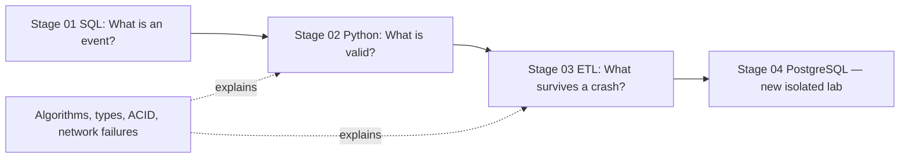

# Foundations Labs — מסלול מונחה ומדורג ב-SQL, Python ו-ETL

[ל-README הראשי](../README.md) · [מפת המסלול](ROADMAP.he.md) · [כללי הערכה](ASSESSMENT.md)

המסלול הזה מתקן פער מרכזי: תיעוד אינו זהה ללמידה. אלו **שלוש מעבדות רצות עם מערכת בדיקה אוטומטית**, שחולקות תרחיש אחד — אירועי רעידות אדמה סינתטיים — ומלמדות מה באמת קורה למידע בדרך מהמקור למסד הנתונים.



## דרישות מקדימות
Python 3.11+ ו-Git מספיקים. אין דרישה ל-Docker, חשבון ענן, חשבון ChatGPT בתשלום או GPU. כל המידע המקומי סינתטי, כל השאילתות רצות על SQLite בזיכרון, וכל בדיקות הקלט נטולות רשת. בקש מהמנטור להתאים קצב לפי אבחון; אל תשלח סיסמאות או מפרט מחשב אישי מלא.

## איך מתחילים — בדיוק
מתיקיית שורש הריפו האישי:

```bash
python3 scripts/validate_repo.py
python3 labs/01-sql/run_lab.py
python3 labs/01-sql/grade.py
```

הבדיקה של `grade.py` צפויה **להיכשל בתחילה**. זה לא באג בתבנית. כעת פתח `labs/01-sql/tasks.sql` ב-VS Code ומלא את המשימות לפי [הוראות SQL](../labs/01-sql/README.md). הרץ שוב עד שכל הדרישות עוברות. המשך ל-[מעבדת Python](../labs/02-python/README.md) ול-[מעבדת ETL](../labs/03-etl/README.md):

```bash
python3 labs/02-python/grade.py
python3 labs/03-etl/grade.py
```

לכל מעבדה יש שני מסלולי בדיקה:

- **לומד:** פקודת `grade.py` ללא דגל; בודקת את הקוד שלו, ומכשילה כשהוא עדיין אינו שלם.
- **מתחזק/CI:** אותה פקודה עם `--reference`; בודקת פתרון ייחוס שנמצא במאגר, כדי לתפוס רגרסיות בהוראות ובמבחנים. הפתרון גלוי למבקר אך **לא אמור לשמש להעתקה לצורך מעבר**.

## קצב מומלץ שאינו מחייב
| שבוע | מה לומדים | מה מוכיחים |
|---|---|---|
| 1 | SQL, NULL, aggregate, window functions, dedup | 4 שאילתות נכונות על שני datasets + הסבר grain |
| 2 | Python, GeoJSON, timestamps, validation | 6 מקרי בדיקה + parser עצמאי |
| 3 | ETL, transaction, replay, quarantine, failure injection | 7 מקרי אינטגרציה + שחזור כשל |
| 4 | הרחבה עצמאית, review, אימון ב-PostgreSQL, השלמת תיקון | PR + הסבר ללא AI + בעיית העברה חדשה |

## מה המנטור עושה בכל שיעור?
1. מציג תקלה אחת ומבקש **ניבוי** לפני ניסוי.
2. מבקש 10 דקות ניסיון עצמאי; מגדיר נקודת עצירה בטוחה.
3. נותן רמז מדורג לפי צורך; לא כותב מיד את הפתרון.
4. בודק את תוצאות הפקודות ומבקש מהלומד לפרש אותן.
5. מחבר ליסוד מדעי המחשב (B-Tree, טיפוסים, ACID/Isolation, Idempotency).
6. בוחר שאלה חדשה שלא הופיעה בפתרון, כדי לבדוק **העברת ידע**.
7. מסכם PR, בדיקות, מגבלות, טעויות, ובוחן את השלב הבא.

## Gate — מתי באמת מסיימים את יסודות 01–03?
- לכל מעבדה ה־grader שלה עובר על גרסת הלומד.
- קיים PR פרטי או ציבורי בריפו האישי, עם תוצאות פקודות ודיון ב-tradeoffs.
- הלומד מסוגל לתקן כשל שלא ראה מראש ולפתור 2 שאלות ללא AI.
- אין טענות על Supabase בענן, Spark או Kafka אם לא הורצו שם בדיקות אמיתיות.
- ההשלמה מוגדרת **self-reported** עד שבודק אנושי או בוחן בלתי תלוי עבר על הראיות. אין תעודת הסמכה מקצועית רשמית אוטומטית.

## תרחישי כשל שחייבים להכיר
| אירוע | מה צריך להוכיח |
|---|---|
| רישום כפול מהמקור | DISTINCT EVENT ולא COUNT שורות |
| ערך `NULL` | הבחנה בין COUNT(*) ל-COUNT(column) |
| שדה מספרי המכיל טקסט/NaN/Boolean | Validation מפורש ללא coercion |
| UTC מול זמן מקומי | תאריכים ו-timezone נשמרים באופן חד-משמעי |
| API מוסיף שדה | לא מאבדים נתונים הכרחיים; שדה לא מוכר מטופל לפי contract |
| Batch מופעל פעמיים | Replay לא מכפיל מידע |
| עדכון ישן מגיע אחרי חדש | גרסה ישנה אינה דורסת את החדשה |
| רשומה פגומה בין תקינות | הסגר עם fingerprint בלבד; איכות לא מתדרדרת בשקט |
| יותר מדי רשומות פגומות | כל batch נבלם באופן אטומי |
| קריסה לפני commit | אפס שורות חלקיות נשארות |

## מה עוד לא נכלל בהרחבה הזאת?
המעבדות הן **השלמת תרגול לשלבים 01–03**, לא כל ההכשרה. שלבים 04–13, פריסה אמיתית ל-Supabase, מדדי Production, אורקסטרציה בענן ופרויקט גמר נדרשים עדיין. תוכנית המימוש נמצאת ב-[Maintainer Roadmap](MAINTAINER-ROADMAP.he.md).
