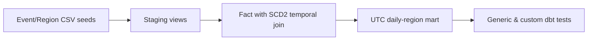

# Stage 05b — dbt Core Analytics Engineering
[Stage 05](../README.md) | [dbt PostgreSQL setup](https://docs.getdbt.com/docs/local/connect-data-platform/postgres-setup)

A standalone dbt Core educational project on **synthetic CSV data**. Reconstructs the same 4-event star schema as the PostgreSQL lab. The pipeline is:



## Run it yourself

Use an isolated, disposable PostgreSQL database (CI provisions one automatically) and Python 3.12. **Never aim the exercise at your production database.** Environment-variable credentials must never be committed.

```bash
python3 -m venv .venv
source .venv/bin/activate
python3 -m pip install "dbt-core==1.11.16" "dbt-postgres==1.11.0"
export DBT_PG_HOST=127.0.0.1 DBT_PG_PORT=5432 DBT_PG_DB=learning DBT_PG_USER=postgres
# Supply DBT_PG_PASSWORD privately for your disposable database.
dbt debug --project-dir labs/05-modeling/dbt --profiles-dir labs/05-modeling/dbt
dbt seed --project-dir labs/05-modeling/dbt --profiles-dir labs/05-modeling/dbt
dbt build --project-dir labs/05-modeling/dbt --profiles-dir labs/05-modeling/dbt
dbt build --project-dir labs/05-modeling/dbt --profiles-dir labs/05-modeling/dbt
```

The first build should succeed; the second proves repeated full-table builds do not accumulate rows. Built-in `unique`, `not_null`, `relationships` tests and custom checks cover missing events, as-of joins, SCD2 overlap, NULL mean and metric reconciliation.

## Learner exercise

Before reading the models, predict why an event in January 1 must use the old name of the East region and January 2 uses the new name. In your own branch, **temporarily remove the historical validity predicates** from the fact join; observe which tests fail, explain cardinality and repair. Then add a new output: count of known magnitude events by region, and write a custom test to reconcile with source. Explain why this is a full-refresh table exercise and not yet incremental dbt or an official certification.

Security: seed fixtures are synthetic. Credentials belong only in environment variables. These dbt models are for a private teaching database; the project has no Supabase cloud deployment or authorization boundary of its own.
