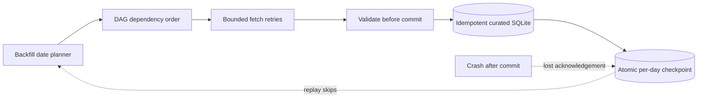

# Stage 06 — Orchestration, Retries & Backfills

[Stage 06 syllabus](../../curriculum/modules/06.md) · [Stage 05 dbt](../05-modeling/dbt/README.md)

A **100% offline** Python + SQLite learning laboratory. No cloud account, Docker, secrets, remote database or GPU is required. The lesson is about building **correct guarantees under failure**, rather than memorizing tool interfaces.



## First steps

From the repository root:

```bash
python3 labs/06-orchestration/grade.py --reference
python3 labs/06-orchestration/grade.py
```

The first command runs **17 tests** against a reference solution. The second is **expected to fail initially**: `starter.py` is intentionally unfinished.

## Implement one capability at a time

1. Implement deterministic `dag_order` and reject missing dependencies and cycles.
2. Implement `backfill_days` for strict ISO dates, inclusive ranges and a 31-day maximum by default.
3. Implement `ensure_schema`: curated event records keyed by event ID, plus a durable per-day run journal.
4. Implement `ingest_day`: retry temporary provider failures within a budget, validate rows, upsert only newer source revisions, and checkpoint successful windows atomically with their data.
5. Simulate failure after Commit but before acknowledgement. Rerun the same window and demonstrate why it must not duplicate data.
6. Re-run a completed window with `force=True` and demonstrate late event correction without overwriting fresher information with stale versions.
7. Design one **new** failure scenario beyond the built-in grader, explain your prediction, then prove it with a test.

## What the grader proves

| Scenario | Expected guarantee |
|---|---|
| Missing DAG dependency or cycle | Reject before execution |
| Multiple independent DAG tasks | Deterministic order |
| Inclusive three-day backfill | Exactly three dates |
| Excessively wide or reversed backfill | Fail closed |
| Two transient errors then success | Three bounded attempts |
| Transient failures exceed budget | Failure recorded, zero curated rows |
| Invalid second event | First event rolled back too |
| Same event retried or out-of-order | At most one event ID, newest revision wins |
| Commit then lost acknowledgement | Restart skips already successful window |
| Reprocess with late source correction | Updates fact without fan-out |

## Broader computer science

DAG scheduling is graph theory; replay and acknowledgement loss are distributed-systems problems; partial writes are transaction/atomicity problems; event day versus source update time is temporal data modeling; checkpoint recovery is a reliability problem.

**Assessment:** learner-authored code, tests passing, a deliberately broken case repaired, a short incident report and two independent questions without AI. Do not copy the instructor reference before attempting the problem. The grader is a classroom exercise, not a production scheduler.

**Scope:** no Apache Airflow/Dagster runtime, distributed concurrency, real HTTP retries, credential handling, on-call paging, cost monitoring or real cloud deployment. Those need separate follow-up labs and independent tests.
