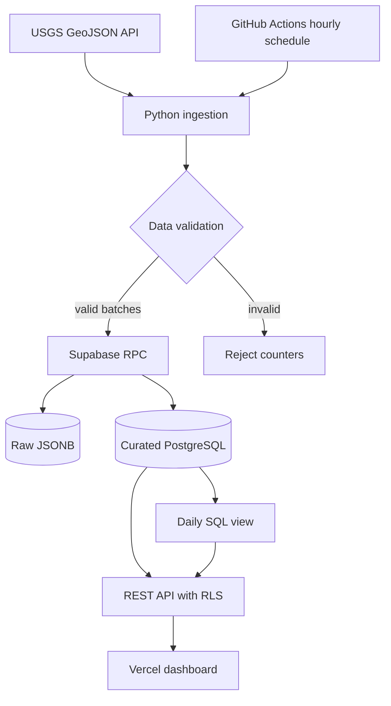

# DataPulse — Data Engineering from API to Production

פרויקט לימודי מלא: **USGS → Python ETL → Supabase PostgreSQL → Dashboard → Deployment**.

> הסטטוס הנוכחי של חבילת הלימוד: קוד ותשתיות מוכנים לבדיקה מקומית; פריסה לענן דורשת פרויקט Supabase ייעודי והרשאות פריסה. אין כאן טענה שפרויקט ענן נוצר או הופעל.

## מבוא: אילו בעיות אנחנו פותרים?

- **Extract:** משיכת נתונים מ-USGS GeoJSON. מקור: https://earthquake.usgs.gov/earthquakes/feed/v1.0/geojson.php
- **Transform:** אימות מזהה, זמנים, קואורדינטות, עוצמה, סוג אירוע, ודחיית רשומות לא תקינות.
- **Load:** כתיבת Raw ו-Curated באותה טרנזקציית PostgreSQL עם upsert לפי `event_id` ומועד עדכון המקור.
- **Quality:** סף פסילה של 25% בשלב ההדגמה, constraints ברמת מסד הנתונים, ובדיקות יחידה.
- **Serve:** שימוש ב-PostgREST לקריאה ציבורית *רק* של נתונים מעובדים, עם RLS ו-GRANT מינימלי.
- **Operate:** GitHub Actions להרצה מחזורית (לאחר הפעלה מפורשת), run logs, יכולת dry-run.
- **Deploy:** Supabase לפריסת DB + Vercel לפריסת ממשק סטטי.

### ארכיטקטורה



### עקרונות חשובים

1. Supabase **אינו** תחליף ל-Spark או Warehouse ייעודי. כאן Postgres מספיק מבחינת היקף המידע.
2. `sb_secret_...` שייך רק ל-Backend או ל-CI; אסור להכניסו ל-JavaScript בדפדפן.
3. `sb_publishable_...` יכול להיחשף בדפדפן, אך רק כשה-RLS וההרשאות הוגדרו נכון.
4. Raw data נגיש למפתח בעל הרשאות בלבד; אנונימי יכול לקרוא רק `earthquakes` ו-`daily_stats`.
5. הזנת אותו אירוע שוב אינה יוצרת שורה נוספת. גרסה חדשה של האירוע עשויה לעדכן שורה קיימת.
6. נתוני הדוגמה תחת `data/sample.geojson` הם **סינתטיים**, ואין להציג אותם כאירועים אמיתיים.

## מיקום במאגר הלימודי

במאגר המאסטרי הזה, קובצי הפרויקט נמצאים תחת `projects/datapulse`. הפקודות המוצגות בדף זה מניחות שנכנסת קודם לתיקייה זו (`cd projects/datapulse`), אלא אם צוין אחרת.

## מבנה התיקיות

```text
src/datapulse/etl.py      # deterministic transformation + quality rules
src/datapulse/ingest.py   # CLI entrypoint, fetching, retry, dry-run
src/datapulse/client.py   # Supabase REST adapter
database/001_init.sql     # PostgreSQL tables, view, RLS, function
web/                      # responsive static dashboard + Vercel API config
.github/workflows/        # tests and scheduled ingestion
data/sample.geojson       # synthetic testing fixture
tests/                    # unittest tests
scripts/                  # CLI-generated migration helper
```

## שלב 1 — הרצה ללא מפתחות וללא עלות ענן

דרישות: Python 3.11+.

```bash
cd datapulse
PYTHONPATH=src python -m unittest discover -s tests -v
PYTHONPATH=src python -m datapulse.ingest --fixture data/sample.geojson --dry-run
```

אחרי האימות המקומי אפשר להריץ Dry Run מול USGS (נדרש חיבור לרשת):

```bash
PYTHONPATH=src python -m datapulse.ingest --feed day --dry-run
```

## שלב 2 — Supabase project

1. היכנס ל-https://supabase.com/dashboard ובחר ארגון והרשאות מתאימים.
2. צור **פרויקט חדש ונפרד** (עדיף קרוב גאוגרפית למשתמשים שלך). בדוק את המחיר לפני יצירה.
3. SQL Editor → New Query → הדבק את `database/001_init.sql` → Run.
4. ב-Table Editor ודא שקיימות: `raw_earthquakes`, `earthquakes`, `ingest_runs`.
5. ב-Database/Views ודא שקיים `daily_stats`.
6. ב-Settings → API Keys צור/העתק Publishable ו-Secret keys. **אל תשתף כאן Secret key.**

לעבודה עם Supabase CLI, יצירת מיגרציה עם שם מקורי של ה-CLI במקום לנחש חותמת זמן:

```bash
supabase --version
supabase init
bash scripts/create_migration.sh
supabase login
supabase link --project-ref YOUR_PROJECT_REF
supabase db push --remote
```

> בחר **או** פריסה דרך SQL Editor **או** דרך migration ב-CLI, כדי לא לבצע תהליך כפול על אותו פרויקט. הדרך המומלצת לפיתוח ארוך טווח היא migrations כגרסת מקור יחידה.

## שלב 3 — טעינה אמיתית ראשונה

קבע את משתני הסביבה בטרמינל או בקובץ `.env` מקומי שלא נכנס ל-Git (מומלץ secret manager):

```bash
export SUPABASE_URL=https://YOUR_PROJECT_REF.supabase.co
export SUPABASE_SECRET_KEY='YOUR_SERVER_SIDE_SECRET_KEY'
PYTHONPATH=src python -m datapulse.ingest --feed day
```

אחר כך בדוק ב-SQL Editor:

```sql
select count(*) from public.raw_earthquakes;
select count(*) from public.earthquakes;
select * from public.daily_stats order by day desc limit 7;
select status, source_rows, valid_rows, rejected_rows, loaded_rows
from public.ingest_runs order by started_at desc limit 5;
```

### בדיקת Idempotency

הרץ את אותה פקודת טעינה פעמיים בהפרש קצר והשווה את מספרי השורות. כל אירוע מזוהה באמצעות `event_id`, ולכן טעינה חוזרת אינה אמורה להוסיף כפילויות. אם המקור התעדכן בין ההרצות, ייתכנו אירועים חדשים או עדכונים תקינים.

## שלב 4 — Dashboard מקומי ו-Vercel

לתצוגה מקומית, צור `web/config.local.js` לפי `web/config.local.example.js` והכניס **רק מפתח Publishable**. הפעל שרת סטטי:

```bash
cd web
python -m http.server 8080
# http://localhost:8080             (דורש Supabase config)
# http://localhost:8080/?demo=1     (דמו סינתטי ללא מפתחות)
```

לפריסה ב-Vercel:

1. העלה את הפרויקט ל-GitHub, וייבא את ה-Repository ב-Vercel.
2. הגדר **Root Directory** כ-`web` ובחר Other/No framework.
3. בהגדרות ה-Environment Variables הוסף `SUPABASE_URL` ו-`SUPABASE_PUBLISHABLE_KEY` (ערכים ציבוריים בלבד).
4. Deploy. אמת ש-`/api/config` מחזיר URL ו-Publishable key בלבד; אחרי כן בדוק טעינת dashboard ללא שגיאות.
5. אם הקריאות נכשלות, בדוק RLS, `GRANT`, והאם Data API פעיל עבור schema `public`.

## שלב 5 — תזמון

לאחר אישור מפורש, העתק את `examples/workflows/ingest.yml.example` ל-`.github/workflows/datapulse-ingest.yml` בשורש הריפו והפעל אותו ב-GitHub Actions (משתנה `DATAPULSE_ENABLED=true`). הוסף **Repository Secrets**:

- `SUPABASE_URL` — כתובת Supabase.
- `SUPABASE_SECRET_KEY` — מפתח שרת, **לעולם לא** כמשתנה ציבורי או בקובץ Git.

לאחר שביצעת טעינה מוצלחת אחת במצב ידני, הוסף **Repository Variable**:

- `DATAPULSE_ENABLED` = `true`

ה-Workflow מוגדר להרצה אחת בשעה ב-UTC, בתלות בתזמון של GitHub (שאינו מובטח לדקה המדויקת).

## שלב 6 — בדיקות אבטחה ואיכות לפני פריסה

- `raw_earthquakes` ו-`ingest_runs` אינם נגישים באמצעות publishable key.
- `earthquakes` ו-`daily_stats` קריאים אך אינם ניתנים לכתיבה עם publishable key.
- פונקציית `ingest_earthquake_batch` אינה זמינה ל-`anon` או ל-`authenticated`.
- אין `SUPABASE_SECRET_KEY` בקבצים הנשלחים לדפדפן או ב-Git.
- HTTP errors/invalid records do not silently pass quality gates.
- `supabase db advisors` או Database Security Advisors: אין ממצאי אבטחה לא מטופלים.
- ביצוע שתי טעינות: אין כפילויות; גרסאות אירועים חדשות מתעדכנות.
- Dashboards: בדוק מצב ריק, כישלון רשת ואירועים עם magnitude חסר.

## מסלול הרחבה לאחר MVP

**v0.2.0:** CDC / change history, backfill עם חלונות תאריכים, Data Contracts.

**v0.3.0:** dbt + DuckDB / Parquet, orchestration עצמאי, lineage.

**v0.4.0:** Kafka streaming, Spark, cost benchmarks, CI integration tests.

## מגבלות MVP

- `all_day.geojson` הוא חלון מתגלגל של היום האחרון, לכן לצורך היסטוריה נדרש גם backfill (דוגמה: `--feed week`).
- `loaded_rows` מציין רשומות שהועברו ל-RPC, **לא** כמה שורות השתנו בפועל.
- בדיקות היחידה אינן מחליפות בדיקות אינטגרציה מול PostgreSQL פעיל.
- ממוצע העוצמה ב-Dashboard מחושב לפי ממוצע יום משוקלל במספר האירועים בעלי ערך magnitude; ערכים חסרים אינם נכללים במכנה.
- Supabase מספק backend. ה-frontend בפרויקט נפרס דרך Vercel.

## מקורות רשמיים

- USGS Feed: https://earthquake.usgs.gov/earthquakes/feed/v1.0/geojson.php
- Supabase Keys: https://supabase.com/docs/guides/getting-started/api-keys
- Supabase RLS: https://supabase.com/docs/guides/database/postgres/row-level-security
- Supabase deployment: https://supabase.com/docs/guides/deployment
- Vercel functions: https://vercel.com/docs/functions


## התאמה ל-Supabase CLI v3 (נובמבר 2026)

ה-CLI החדש פועל **מקומית כברירת מחדל**. כל שינוי בפרויקט מאוחסן מחייב בחירה מכוונת ב-`--remote`, ולפעולות לא אינטראקטיביות גם `--yes` לאחר סקירת השינוי. אל תעתיק פקודות ישנות בלי בדיקה עם `supabase --help`, `supabase db --help` ו-`supabase db push --help`.

מקור רשמי: https://supabase.com/changelog/supabase-cli-v3

**הערה:** הקוד המצורף הוא פרויקט לימודי שצריך לבדוק מול סביבת Supabase ייעודית; אין לטעון שפריסה או בדיקת RLS חיצונית הושלמו ללא ראיות.
